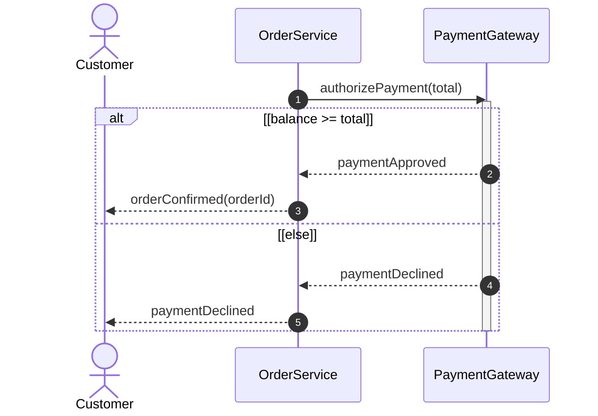

# ANTLR v4 to UML Sequence Diagram Mappings

This document defines the architecture and grammar mapping specification for ingesting source code via **ANTLR v4** and automatically synthesizing **OMG UML 2.5.1 Sequence Diagrams** with **Combined Fragments** (`alt`, `opt`, `loop`, `break`, `par`).

---

## 1. High-Level Ingestion Architecture

```
+--------------------+        +---------------------+        +---------------------------------+
| Source Code        |        | ANTLR v4 Parser     |        | SequenceDiagramIngestionListener|
| (Python, Java, etc)| -----> | ParseTree / Lexer   | -----> | (ParseTreeListener / Visitor)   |
+--------------------+        +---------------------+        +---------------------------------+
                                                                             |
                                                                             v
+--------------------+        +---------------------+        +---------------------------------+
| Sequence Diagram   | <----- | SDLayoutEngine      | <----- | SequenceDiagramBuilder          |
| (umlshapes canvas) |        | (Time-step layout)  |        | (umlmodel AST to SD elements)   |
+--------------------+        +---------------------+        +---------------------------------+
```

1. **ANTLR v4 Grammar & Parser:** Ingests raw source code and emits structured parse-tree events (`enter*` / `exit*`).
2. **`SequenceDiagramIngestionListener`:** Maintains an active stack of execution contexts and combined fragments.
3. **`SequenceDiagramBuilder`:** Translates language events into UML Sequence Diagram elements (`UmlSDInstance`, `UmlSDMessage`, `UmlSDExecution`, `UmlSDCombinedFragment`).
4. **`SDLayoutEngine`:** Automatically assigns participant columns, discrete vertical time steps, and bounding boxes for fragments and executions.

---

## 2. ANTLR Rule to Sequence Diagram Element Mapping

| Language Construct | ANTLR v4 Rule (e.g. Python3) | UML Sequence Diagram Element | Fragment Operator | Guard Condition / Details |
|---|---|---|---|---|
| **Class Definition** | `enterClassdef(ctx)` | `UmlSDInstance` (Participant) | — | Instance name: `ctx.NAME().getText()` |
| **Method Definition** | `enterFuncdef(ctx)` | Participant Lifeline Entry Point | — | Creates initial execution specification on participant |
| **Method Call** | `enterExpr_stmt` / `trailer` / `call` | `UmlSDMessage` (Call Message) | — | Synchronous message `caller -> receiver.method()` |
| **Return Statement** | `enterReturn_stmt(ctx)` | `UmlSDMessage` (Return Message) | — | Dashed return message to previous activation |
| **If (no else)** | `enterIf_stmt(ctx)` (without `else`/`elif`) | Combined Fragment | **`opt`** | Guard: `[ctx.test().getText()]` |
| **If / Elif / Else** | `enterIf_stmt(ctx)` (with `else` or `elif`) | Combined Fragment | **`alt`** | Operand 1 Guard: `[ctx.test().getText()]` |
| **Elif Clause** | `enterElif_clause(ctx)` | Operand Divider (`- - -`) | **`alt`** | New Operand Guard: `[ctx.test().getText()]` |
| **Else Clause** | `enterElse_clause(ctx)` | Operand Divider (`- - -`) | **`alt`** | New Operand Guard: `[else]` |
| **While Loop** | `enterWhile_stmt(ctx)` | Combined Fragment | **`loop`** | Guard: `[ctx.test().getText()]` |
| **For Loop** | `enterFor_stmt(ctx)` | Combined Fragment | **`loop`** | Guard: `[for ctx.exprlist() in ctx.testlist()]` |
| **Try / Except** | `enterTry_stmt(ctx)` | Combined Fragment | **`break`** or **`alt`** | Operand 1: Normal try body<br>Operand 2+: `[except Exception]` |
| **Async Gather / Tasks** | `enterAsync_funcdef` / `gather()` | Combined Fragment | **`par`** | Parallel concurrent execution lanes |

---

## 3. Combined Fragment Metamodel & Visual Structure (UML 2.5.1 Section 17.6)



### Visual Components (OMG UML 2.5.1 Section 17.6)

| Component | Visual Notation | Specification Details |
|---|---|---|
| **Outer Boundary Frame** | Solid rectangle | Encloses the participating lifelines and vertical time steps involved |
| **Operator Compartment** | Top-left notched pentagon badge | Displays the interaction operator (`alt`, `opt`, `loop`, `par`, `break`) |
| **Operand Compartments** | Sub-regions within the frame | Distinct interaction branches (e.g. `if` branch vs `else` branch) |
| **Dashed Divider Lines** | Horizontal dashed line (`- - -`) | Divides alternative operands within multi-operand fragments (`alt`, `par`) |
| **Guard Conditions** | Square brackets `[condition]` | Placed near the top-left of each operand compartment |

---

## 4. Ingestion Listener Implementation Pattern

The ingestion listener uses a **fragment stack** to maintain hierarchical lexical scopes:

```python
from typing import Optional
from typing import List

class FragmentContext:
    def __init__(self, operator: str, initialGuard: str, startStep: int):
        self.operator: str = operator
        self.guards: List[str] = [initialGuard]
        self.startStep: int = startStep
        self.endStep: int = startStep
        self.operandDividers: List[int] = []  # Time-step indices of horizontal dividers


class SequenceDiagramIngestionListener(Python3ParserBaseListener):
    """
    Translates ANTLR parse-tree events into sequence diagram model elements.
    """

    def __init__(self, builder: SequenceDiagramBuilder):
        self._builder: SequenceDiagramBuilder = builder
        self._fragmentStack: List[FragmentContext] = []

    # -------------------------------------------------------------------------
    # Conditionals: alt / opt
    # -------------------------------------------------------------------------
    def enterIf_stmt(self, ctx: Python3Parser.If_stmtContext):
        hasAlternatives: bool = bool(ctx.ELIF() or ctx.ELSE())
        operator: str = 'alt' if hasAlternatives else 'opt'
        guardText: str = ctx.test().getText()

        currentStep: int = self._builder.currentLayoutStep
        fragment: FragmentContext = FragmentContext(operator=operator, initialGuard=guardText, startStep=currentStep)
        self._fragmentStack.append(fragment)

    def enterElif_clause(self, ctx: Python3Parser.Elif_clauseContext):
        if self._fragmentStack:
            activeFragment: FragmentContext = self._fragmentStack[-1]
            guardText: str = ctx.test().getText()
            activeFragment.guards.append(guardText)
            activeFragment.operandDividers.append(self._builder.currentLayoutStep)

    def enterElse_clause(self, ctx: Python3Parser.Else_clauseContext):
        if self._fragmentStack:
            activeFragment: FragmentContext = self._fragmentStack[-1]
            activeFragment.guards.append('else')
            activeFragment.operandDividers.append(self._builder.currentLayoutStep)

    def exitIf_stmt(self, ctx: Python3Parser.If_stmtContext):
        if self._fragmentStack:
            fragment: FragmentContext = self._fragmentStack.pop()
            fragment.endStep = self._builder.currentLayoutStep
            self._builder.addCombinedFragment(fragment)

    # -------------------------------------------------------------------------
    # Iteration: loop
    # -------------------------------------------------------------------------
    def enterWhile_stmt(self, ctx: Python3Parser.While_stmtContext):
        guardText: str = ctx.test().getText()
        fragment: FragmentContext = FragmentContext(operator='loop', initialGuard=guardText, startStep=self._builder.currentLayoutStep)
        self._fragmentStack.append(fragment)

    def exitWhile_stmt(self, ctx: Python3Parser.While_stmtContext):
        if self._fragmentStack:
            fragment: FragmentContext = self._fragmentStack.pop()
            fragment.endStep = self._builder.currentLayoutStep
            self._builder.addCombinedFragment(fragment)

    def enterFor_stmt(self, ctx: Python3Parser.For_stmtContext):
        guardText: str = f'for {ctx.exprlist().getText()} in {ctx.testlist().getText()}'
        fragment: FragmentContext = FragmentContext(operator='loop', initialGuard=guardText, startStep=self._builder.currentLayoutStep)
        self._fragmentStack.append(fragment)

    def exitFor_stmt(self, ctx: Python3Parser.For_stmtContext):
        if self._fragmentStack:
            fragment: FragmentContext = self._fragmentStack.pop()
            fragment.endStep = self._builder.currentLayoutStep
            self._builder.addCombinedFragment(fragment)
```

---

## 5. Participant & Message Resolution Strategy

When an expression statement represents a method call (`receiver.methodName(arg1, arg2)`):

1. **Caller Lifeline:** The enclosing method's participant instance (`self` or current active execution).
2. **Receiver Lifeline:**
   - Attribute target (`self.orderService` -> resolves to `OrderService` participant).
   - Local variable with known type annotation (`gateway: PaymentGateway = ...` -> resolves to `PaymentGateway`).
   - If unresolved, maps to an external participant instance or a `LOST` message.
3. **Execution Synchronization:**
   - A synchronous call automatically spawns an `UmlSDExecution` specification bar on the target participant lifeline.
   - Return message (`return value`) ends the execution specification bar and routes back to the caller.

---

## 6. Multi-Language Extensibility

Because ANTLR v4 decouples the grammar from the runtime:
- **Python:** Use `Python3.g4` grammar (`If_stmtContext`, `While_stmtContext`).
- **Java:** Use `JavaParser.g4` grammar (`StatementContext` with `if`, `while`, `for`, `switch`).
- **TypeScript / JavaScript:** Use `TypeScriptParser.g4` grammar.

The backend `SequenceDiagramBuilder`, `SDLayoutEngine`, and `umlshapes` components remain **100% language-agnostic**.
