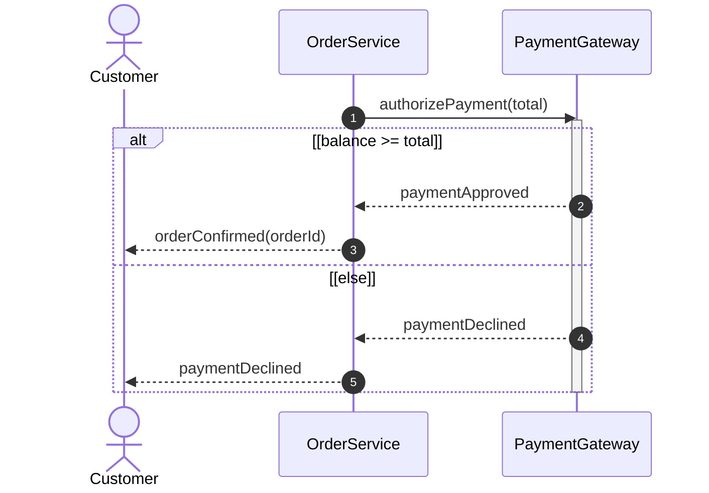
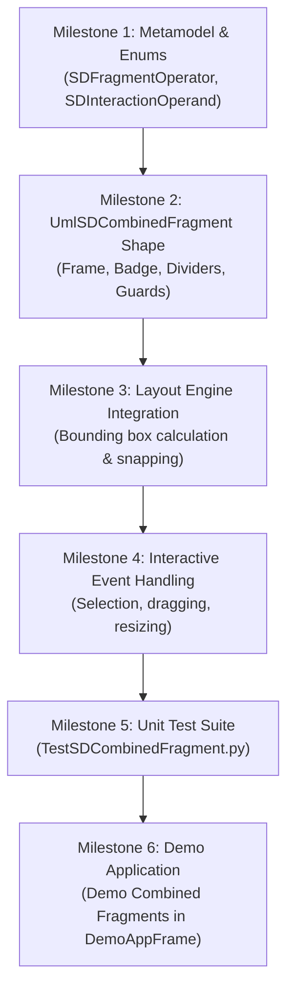

# Implementation Plan: Phase 2, Item 2 — Combined Fragments (`UmlSDCombinedFragment`)

## Goal
Implement **Combined Fragments** in the Sequence Diagram subsystem (`umlshapes/sd`) conforming to the **OMG UML 2.5.1 standard (Section 17.6 Combined Fragments)**, providing visual containers with operator badges (`alt`, `opt`, `loop`, `par`, `break`), operand compartments, dashed divider lines, guard conditions, and interactive canvas manipulation.

---

## Metamodel & Visual Notation (OMG UML 2.5.1 Section 17.6)

### Visual Components (OMG UML 2.5.1 Section 17.6)

| Component | Visual Notation | Specification Details |
|---|---|---|
| **Outer Boundary Frame** | Solid rectangle | Encloses the participating lifelines and vertical time steps involved |
| **Operator Compartment** | Top-left notched pentagon badge | Displays the interaction operator (`alt`, `opt`, `loop`, `par`, `break`) |
| **Operand Compartments** | Sub-regions within the frame | Distinct interaction branches (e.g. `if` branch vs `else` branch) |
| **Dashed Divider Lines** | Horizontal dashed line (`- - -`) | Divides alternative operands within multi-operand fragments (`alt`, `par`) |
| **Guard Conditions** | Square brackets `[condition]` | Placed near the top-left of each operand compartment |

---

## Phased Milestones

---

### **Milestone 1: Metamodel & Data Structures**
* Create `src/umlshapes/sd/SDFragmentOperator.py`:
  - Enum containing `ALT`, `OPT`, `LOOP`, `PAR`, `BREAK`, `CRITICAL`.
* Create `src/umlshapes/sd/SDInteractionOperand.py`:
  - Data class defining an operand compartment: `guard: str`, `startTimeStep: int`, `endTimeStep: int`.
* Define preference defaults in `UmlPreferences`:
  - `fragmentHeaderWidth`, `fragmentHeaderHeight`, `fragmentDefaultPadding`.

---

### **Milestone 2: `UmlSDCombinedFragment` Shape Class**
* Create `src/umlshapes/sd/UmlSDCombinedFragment.py`:
  - Subclasses `RectangleShape`, `ControlPointMixin`, `IdentifierMixin`, `TopLeftMixin`.
  - Properties: `operator: SDFragmentOperator`, `operands: list[SDInteractionOperand]`.
  - Methods: `addOperand(guard: str)`, `removeOperand(index: int)`.
  - **Custom Drawing (`OnDraw`):**
    - Draw outer bounding rectangle (red dashed when selected, solid black when unselected).
    - Draw top-left operator compartment badge (with pentagonal/notched border).
    - Draw operator text (`alt`, `loop`, etc.) inside the badge.
    - Draw horizontal dashed divider lines between operands.
    - Draw guard text strings `[guard]` inside each operand.
  - **Hit Testing (`HitTest`):**
    - Support clicking the boundary frame, header badge, and interior regions.

---

### **Milestone 3: Layout Engine Integration**
* Extend `src/umlshapes/sd/SDLayoutEngine.py`:
  - `computeFragmentBounds(lifeLines: list[UmlSDLifeLine], startY: int, endY: int) -> tuple[int, int, int, int]`:
    - Computes `(centerX, centerY, width, height)` with standard padding to span across the involved lifelines.
  - `snapFragmentToTimeSteps(startY: int, endY: int) -> tuple[int, int]`:
    - Snaps top and bottom edges to discrete diagram time steps.

---

### **Milestone 4: Event Handling & Interactive Manipulation**
* Create `src/umlshapes/sd/eventhandlers/UmlSDCombinedFragmentEventHandler.py`:
  - **Selection:** `OnLeftClick` highlights the fragment and broadcasts `UML_SHAPE_SELECTED`.
  - **Moving:** `OnBeginDragLeft`, `OnDragLeft`, `OnEndDragLeft` move the fragment vertically snapped to time steps.
  - **Resizing:** Corner and edge control points allow resizing width across lifelines and height across time steps.

---

### **Milestone 5: Unit Test Suite**
* Create `tests/umlshapes/sd/TestSDCombinedFragment.py`:
  - Unit tests verifying:
    1. Shape instantiation, default properties, and operator types.
    2. Adding/removing operands and divider line calculation.
    3. Geometry computation across multiple lifelines.
    4. Guard label placement and text rendering.
    5. Selection, hit testing, and resizing behavior.
  - Verification: 100% test pass rate and 0 mypy issues.

---

### **Milestone 6: Demo Application Integration**
* Update `tests/demo/DemoAppFrame.py` and `tests/demo/DemoCommon.py`:
  - Add menu item: **`Demo Combined Fragments`** under the Sequence Diagram menu.
  - Spawns a pre-canned sequence diagram showcasing:
    - 3 participants: `Customer`, `OrderService`, `PaymentGateway`.
    - A `loop` fragment: `[for each item in cart]`.
    - An `alt` fragment with 2 operands separated by a dashed divider: `[balance >= total]` vs. `[else]`.
    - Interactive selection and resizing on the live canvas.
