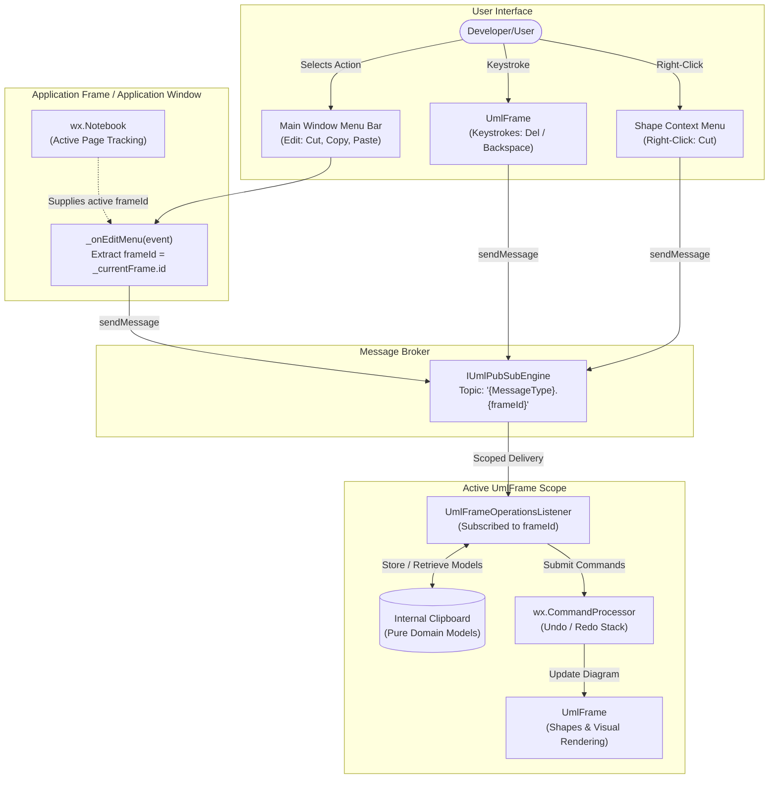
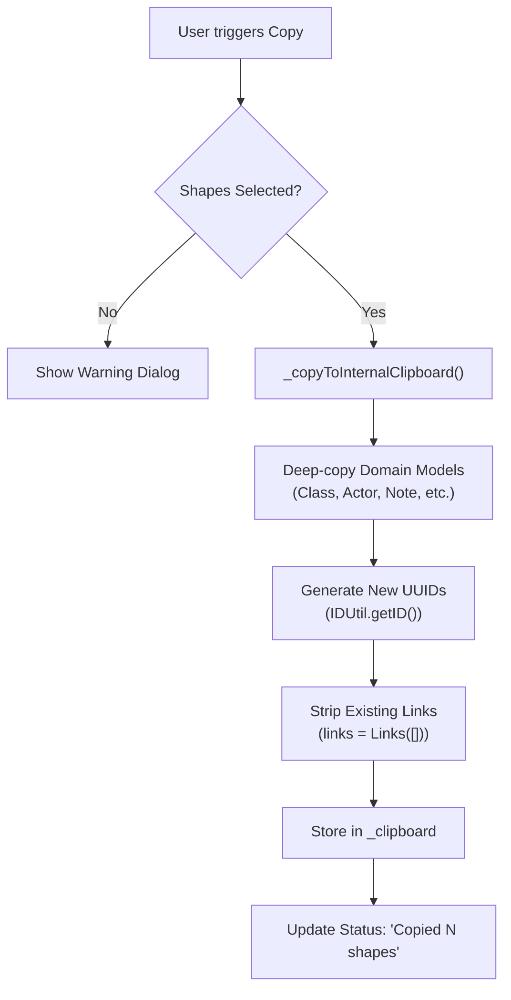
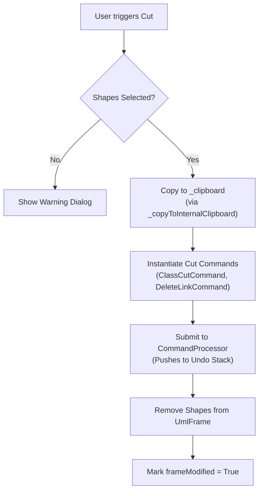
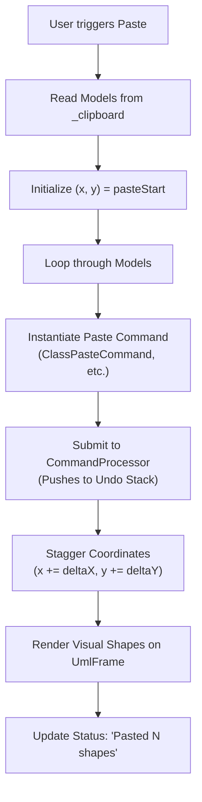
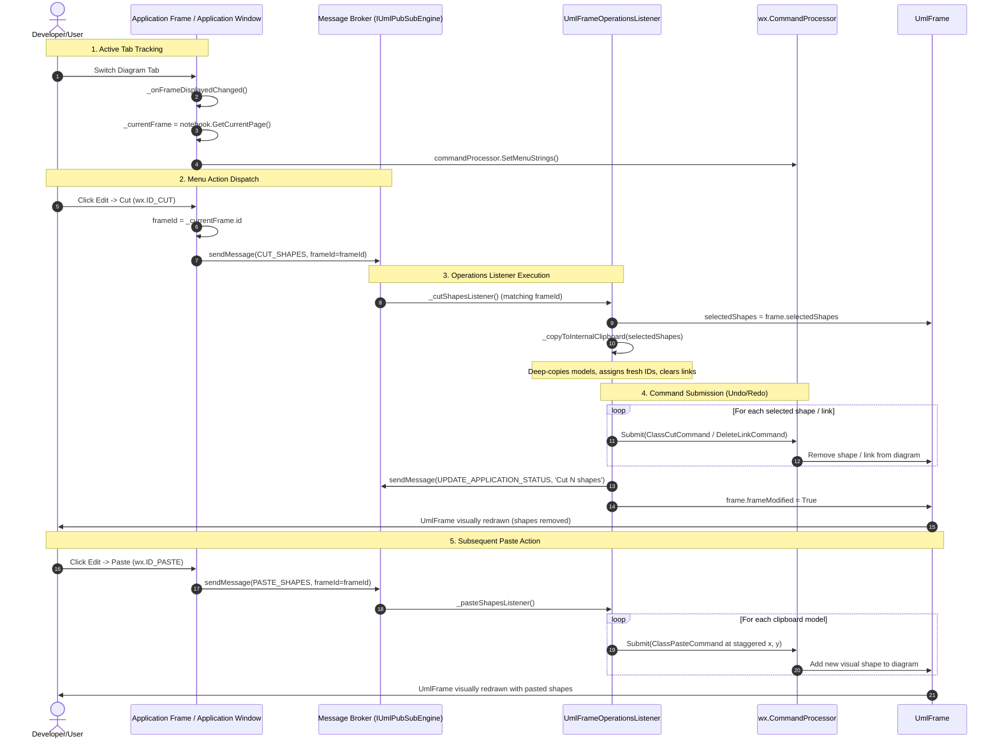

# Cut, Copy, and Paste Architecture

## 1. Executive Summary

In multi-diagram UML editing systems (such as the `umldiagrammer`), the application interface features a tabbed notebook (`wx.Notebook`) hosting multiple independent diagrams (`ClassDiagramFrame`, `UseCaseDiagramFrame`, `SequenceDiagramFrame`).

While each diagram frame owns its own diagram frame, shapes, selection state, and undo/redo history, the top-level application window maintains a unified system menu bar with standard **Edit** menu options (`Undo`, `Redo`, `Cut`, `Copy`, `Paste`, `Select All`).

This document details the architectural mechanisms employed by `umlshapes` to:

1. Accurately resolve and track the currently active diagram frame.
2. Dynamically route menu commands and accelerators exclusively to the active frame via scoped pub-sub messaging.
3. Ensure domain model integrity, unique identity re-generation, and link detachment during clipboard operations.
4. Provide full, symmetrical **Undo** and **Redo** capabilities for all mutating clipboard operations through the **Command Pattern**.

---

## 2. System Architecture & Active Frame Resolution

The interaction between the top-level application window and individual diagram frames is completely decoupled via the publish-subscribe messaging layer (`IUmlPubSubEngine`).


*Figure 1: Architectural Decoupling and Frame-Scoped Pub-Sub Routing*

### 2.1 Active Frame Tracking

The top-level window (`DemoAppFrame`) listens for notebook tab switches using the wxPython `wx.EVT_NOTEBOOK_PAGE_CHANGED` event:

Every diagram frame (`DiagramFrame`, the base class for `UmlFrame`) is assigned a globally unique identifier upon instantiation:

### 2.2 Frame-Scoped Pub-Sub Routing

When an Edit menu action occurs, `DemoAppFrame._onEditMenu` extracts the current frame’s ID and dispatches a message via `IUmlPubSubEngine`:

The underlying `UmlPubSubEngine` structures topics hierarchically by appending the `frameId`:

```python
def _toTopic(self, eventType: UmlMessageType, frameId: FrameId) -> Topic:
    return Topic(f'{eventType.value}.{frameId}')
```

Because subscribers only listen to topics matching their specific `frameId`, background/inactive tabs remain completely untouched by menu dispatches.

---

## 3. The Frame Operations Listener

Each `UmlFrame` creates a dedicated `UmlFrameOperationsListener` during initialization. This listener encapsulates all editing operations, command submissions, and clipboard handling.

### 3.1 Decoupling the Clipboard from GUI Widgets

A key architectural principle of `umlshapes` is that the clipboard (`self._clipboard`) **never stores GUI shapes** (`wx.lib.ogl.Shape`). Instead, it stores pure domain model instances (`umlmodel` objects such as `Class`, `Actor`, `Note`, `UseCase`, `Text`, `SDMessage`).

This cleanly decouples clipboard state from wxPython graphics contexts, rendering engines, and stale GUI parent pointers.

---

## 4. Operation Lifecycles & State Transitions

The following sections detail the execution flows and state transitions for Copy, Cut, and Paste operations.

### 4.1 Copy Flow (`_copyShapesListener`)


*Figure 2a: Copy Flow*

1. **Selection Validation:** Queries `selectedShapes = self._umlFrame.selectedShapes`. If empty, shows an error dialog.
2. **Clipboard Reset:** Flushes the existing `self._clipboard`.
3. **Deep Copy of Domain Models:** Iterates over each selected shape and deep-copies its underlying domain model (e.g. `deepcopy(umlShape.modelClass)`).
4. **UUID Regeneration:** Assigns a fresh UUID using `linkedObject.id = IDUtil.getID()` so future paste instances have unique domain identity.
5. **Link Stripping:** Clears attached links (`linkedObject.links = Links([])`) to avoid dangling pointers or orphaned connections upon paste.
6. **User Feedback:** Emits `UmlMessageType.UPDATE_APPLICATION_STATUS` with the count of copied shapes.

### 4.2 Cut Flow (`_cutShapesListener`)


*Figure 2b: Cut Flow*

1. **Internal Copy:** Executes `_copyToInternalClipboard(selectedShapes)` so cut shapes can immediately be pasted elsewhere.
2. **Command Pattern Encapsulation:** For each selected shape, a corresponding undoable command is instantiated:
   * Shapes (`UmlClass`, `UmlActor`, `UmlNote`, `UmlText`, `UmlUseCase`) generate `*CutCommand` (e.g., `ClassCutCommand`).
   * Links generate `DeleteLinkCommand`.
   * Sequence Diagram messages generate `DeleteSDMessageCommand`.
3. **Command Processor Submission:** Submitting via `self._umlFrame.commandProcessor.Submit(command)` executes the deletion and pushes the inverse action onto the Undo stack.
4. **Frame Modification:** Sets `self._umlFrame.frameModified = True` and updates the application status bar.

### 4.3 Paste Flow (`_pasteShapesListener`)


*Figure 2c: Paste Flow*

1. **Preference Retrieval:** Reads starting coordinates (`preferences.pasteStart`) and coordinate deltas (`preferences.pasteDeltaXY`).
2. **Iterative Placement:** For each domain model in `self._clipboard`:
   * Instantiates the corresponding paste command (e.g., `ClassPasteCommand`, `ActorPasteCommand`, `NotePasteCommand`).
   * Submits the command to `self._umlFrame.commandProcessor.Submit(...)`.
   * Increments coordinates by `deltaX` and `deltaY` (default: 20px) to prevent overlapping shapes.
3. **Fidelity:** Because each paste action is processed through a command, pasting is fully undoable.

---

## 5. Alternative Interaction Triggers

In addition to the top-level application **Edit** menu, Cut/Copy/Paste operations can be triggered through two additional interaction channels:

### 5.1 Keyboard Accelerators (`UmlFrame._onProcessKeystrokes`)

When focus is on the diagram frame (`UmlFrame`), pressing the **Delete** or **Backspace** keys routes directly to the cut pipeline:

```python
def _onProcessKeystrokes(self, event: KeyEvent):
    c: int = event.GetKeyCode()
    match c:
        case UmlFrame.KEY_CODE_BACK | UmlFrame.KEY_CODE_DELETE:
            self._umlPubSubEngine.sendMessage(UmlMessageType.CUT_SHAPES, frameId=self.id)
```

### 5.2 Context Popup Menus (`UmlClassMenuHandler`)

Right-clicking a shape opens a context menu that includes shape-specific editing actions:

```python
elif eventId == ID_CUT_SHAPE:
    self._umlClass.selected = True
    self._umlPubSubEngine.sendMessage(UmlMessageType.CUT_SHAPES, frameId=frameId)
```

---

## 6. End-to-End Sequence Diagram

The following sequence diagram illustrates the complete execution flow from user menu click through message dispatch to command execution:


*Figure 3: End-to-End Sequence Diagram from Menu Click to UmlFrame Update*

---

## 7. Component Responsibilities & Design Rules

| Component | Responsibility | Design Rule |
| :--- | :--- | :--- |
| `AppFrame` | Top-level window & menu bar owner | Knows the active `_currentFrame`; dispatches generic pub-sub messages tagged with `frameId`. |
| `FrameId` | Frame identity | Immutable string identifier generated per `DiagramFrame`. |
| `IUmlPubSubEngine` | Message broker | Formats topics as `{MessageType}.{frameId}`; prevents cross-frame event leakage. |
| `UmlFrameOperationsListener` | Editing orchestrator | Subscribed to its owning frame’s topics; maintains private `_clipboard`. |
| `self._clipboard` | In-memory clipboard storage | Stores deep-copied pure domain model instances (`umlmodel`), never GUI shapes. |
| `CommandProcessor` | History manager | All Cut and Paste actions are wrapped in `wx.Command` objects to guarantee full Undo/Redo fidelity. |
