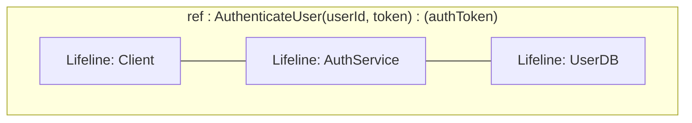

# Deferred Sequence Diagram Features (OMG UML 2.5.1)

This document specifies three advanced OMG UML 2.5.1 Sequence Diagram features deferred from Phase 2 for future implementation:

1. **Interaction Uses / Reference Frames (`ref`)** (§17.7)
2. **Gates & Diagram Boundary Endpoints** (§17.8)
3. **State Invariants / Condition Assertions** (§17.9)

---

## 1. Interaction Uses / Reference Frames (`ref`) (OMG UML 2.5.1 §17.7)

### 1.1. Overview & Purpose
An **Interaction Use** (commonly referred to as a **Reference Frame** or `ref` frame) enables sequence diagram modularity and decomposition. It represents a call to an entire external Sequence Diagram from within the current diagram, allowing complex multi-step protocols (such as authentication handshakes, payment processing, or error recovery) to be encapsulated and reused across multiple diagrams.

### 1.2. Visual Notation


- **Boundary Frame:** A solid rectangular container enclosing the lifelines participating in the referenced interaction over a specific vertical duration.
- **Operator Badge:** A notched pentagonal badge located in the top-left corner displaying the operator keyword `ref`.
- **Reference Label:** Text centered inside the frame specifying the referenced sequence diagram name, optional arguments, and return attributes:
  ```text
  ref: <InteractionName>[(<arguments>)] [: <returnAttributes>]
  ```
- **Lifeline Coverage:** Lifelines that participate pass through the frame, while non-participating lifelines remain outside.

### 1.3. Architecture & Metamodel Design
- **Model:** `SDInteractionUse` in `umlmodel` containing:
  - `referencedInteractionName: str`
  - `arguments: list[str]`
  - `returnValues: list[str]`
  - `coveredLifelines: list[str]`
  - `startTimeStep: int`, `endTimeStep: int`
- **Shape (`UmlSDInteractionUse`):**
  - Inherits from `RectangleShape`, `ControlPointMixin`, `IdentifierMixin`, `TopLeftMixin`.
  - Implements custom `OnDraw`:
    - Outer border rectangle.
    - Top-left notched pentagon badge displaying `'ref'`.
    - Centered reference expression text.
  - Sizing & dragging: 8-point control points for manual width/height adjustment with vertical time-step snapping.
- **Event Handler (`UmlSDInteractionUseEventHandler`):**
  - Double-click to invoke an edit dialog (`DlgEditInteractionUse`) for modifying the referenced diagram name and arguments.
  - Dragging and resizing with time-step snapping via `SDLayoutEngine`.

---

## 2. Gates & Boundary Endpoints (OMG UML 2.5.1 §17.8)

### 2.1. Overview & Purpose
A **Gate** is a connection point for messages on the boundary of an Interaction frame or Combined Fragment. Gates allow messages to enter or leave an interaction scope without requiring the sender or receiver participant inside that specific scope to be fully declared:
- **Formal Gate:** Located on the outer boundary frame of a diagram or combined fragment.
- **Actual Gate:** Located on the boundary of an Interaction Use (`ref`) frame, connecting external messages to the formal gates of the referenced diagram.

### 2.2. Visual Notation
```
Outer Frame Boundary
      |
      o====== [Message from outside] ======> Lifeline A
  (Gate)
```
- A discrete anchor point situated on the outer diagram boundary line or on the border of a Combined Fragment / Reference Frame.
- Messages originate from or terminate directly on the gate point rather than on a participant lifeline.

### 2.3. Architecture & Metamodel Design
- **Model:** `SDGate` in `umlmodel` containing:
  - `gateName: str`
  - `gateType: enum` (`FORMAL_GATE`, `ACTUAL_GATE`)
  - `ownerFrameId: str` (ID of diagram frame, combined fragment, or interaction use)
  - `timeStep: int`
- **Visual Element (`UmlSDGate`):**
  - Rendered as an attachment anchor on the frame border (e.g. small circle or diamond marker on selection).
  - Can serve as the source (`fromShape`) or destination (`toShape`) for `UmlSDMessage`.
- **Message Integration:**
  - Update `SDMessageCreationHandler` and `UmlSDMessage` to allow connecting endpoints to gate anchors in addition to `UmlSDLifeLine` and lost/found endpoints.

---

## 3. State Invariants / Condition Assertions (OMG UML 2.5.1 §17.9)

### 3.1. Overview & Purpose
A **State Invariant** is a runtime assertion placed along a participant's lifeline that must evaluate to true at that specific point in time. It represents a state condition (e.g. `{state == Connected}`, `{buffer.isAvailable()}`) or an explicit state transition that the lifeline instance is required to satisfy before proceeding.

### 3.2. Visual Notation

OMG UML 2.5.1 defines two acceptable visual representations:

#### Notation A: Constraint Expression (Textual)
```
    |
    |
{status == Authenticated}
    |
    |
```
- A text constraint enclosed in curly braces `{condition}` placed directly on the lifeline's center axis.

#### Notation B: State Invariant Symbol (Rounded Compartment)
```
    |
  /---------\
 (  Active   )
  \---------/
    |
```
- A rounded rectangle with flat top and bottom, or oval symbol superimposed on the lifeline, occluding the dashed line with an opaque fill and displaying the state name.

### 3.3. Architecture & Metamodel Design
- **Model:** `SDStateInvariant` in `umlmodel` containing:
  - `participantId: str`
  - `invariantExpression: str` (e.g. `state == Ready`)
  - `timeStep: int`
  - `notationStyle: enum` (`CONSTRAINT_TEXT`, `STATE_SYMBOL`)
- **Shape (`UmlSDStateInvariant`):**
  - Inherits from `CompositeShape` or `RectangleShape`, `TopLeftMixin`, `IdentifierMixin`.
  - Centered horizontally on the parent `UmlSDLifeLine`.
  - Snaps vertically to diagram time steps via `SDLayoutEngine`.
  - Background fill occludes the dashed lifeline underneath.
- **Event Handler (`UmlSDStateInvariantEventHandler`):**
  - `OnLeftDoubleClick`: Opens `DlgEditStateInvariant` to edit the condition string or switch visual notation style.
  - `OnDragLeft`: Vertical movement constrained to the lifeline axis with discrete time-step snapping.

---

## 4. Implementation Milestone Plan (When Resumed)

When scheduled for implementation, these features should proceed in the following order:

| Milestone | Feature | Key Deliverables |
|---|---|---|
| **Milestone 1** | **State Invariants** (§17.9) | • `SDStateInvariant` model<br>• `UmlSDStateInvariant` shape with constraint & state symbol styles<br>• Lifeline vertical snapping and double-click editing<br>• Unit test suite `TestSDStateInvariant.py` |
| **Milestone 2** | **Interaction Uses (`ref`)** (§17.7) | • `SDInteractionUse` model<br>• `UmlSDInteractionUse` frame with top-left `ref` badge<br>• Layout engine bounding calculation spanning covered lifelines<br>• Double-click editing dialog `DlgEditInteractionUse`<br>• Unit test suite `TestSDInteractionUse.py` |
| **Milestone 3** | **Boundary Gates** (§17.8) | • `SDGate` model and `UmlSDGate` anchor points<br>• Frame and fragment border attachment integration<br>• Message creation and routing into/out of gates<br>• Unit test suite `TestSDGate.py` |
